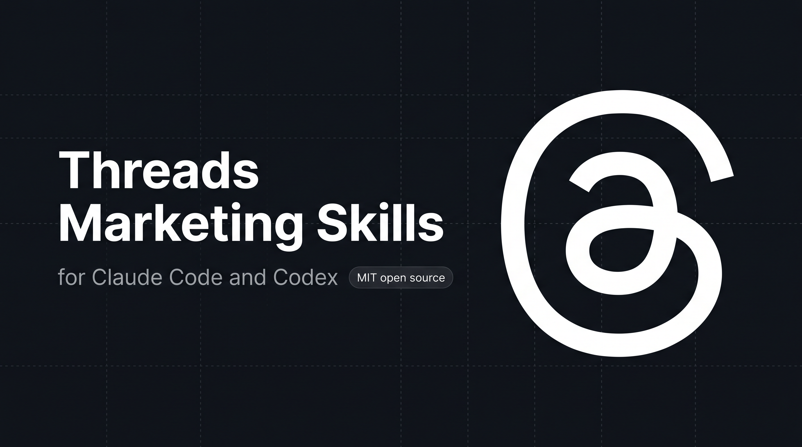

<p align="center">
  
</p>

[English](README.en.md) | **Français**

# Skills de marketing Threads pour Claude Code et Codex

<p align="center">
  
  
  
  
  
  
  
</p>

**8 skills qui transforment Claude Code et Codex en équipe de contenu pour Threads.** Ils écrivent des posts et des threads avec ta voix et des hooks validés sur un corpus, rédigent des réponses, lisent ta niche à partir de données réelles et planifient une semaine de contenu. Chaque brouillon est débarrassé des tics d'IA et attend ta validation avant toute publication. Aucun code requis.

Une fois installé, demande simplement à Claude Code ou à Codex, par exemple :

- "Écris un post Threads sur [sujet]"
- "Transforme ces notes en thread"
- "Qu'est-ce qui marche sur Threads dans ma niche ? (lit de vraies données via Apify)"
- "Réécris ça pour que ça sonne humain"

Le bon skill s'active automatiquement. Tu relis et tu valides ensuite.

## Installation

### Recommandé : claude.ai (sans ligne de commande, testé)

1. Ouvre https://claude.ai et clique sur **Personnalisation** dans la barre latérale gauche, puis sur l'onglet **Plugins**
2. Clique sur **+ Ajouter**, puis **Ajouter une place de marché**, puis **Ajouter depuis un dépôt**
3. Sélectionne ou saisis `NeedyMindset/needythreads` et clique sur **Synchro**
4. **Needythreads** apparaît dans la liste. Clique sur **Ajouter**. Un message confirme qu'il est installé et prêt à être utilisé
5. Lance une nouvelle conversation et demande : « Écris un post Threads sur [sujet] ». Les skills ne se chargent que dans une nouvelle conversation.

Un bandeau peut te demander d'accorder à la Claude GitHub App l'accès au dépôt. Tu peux l'ignorer : le plugin fonctionne sans, et cela ne sert qu'aux mises à jour automatiques (voir [Mettre à jour le plugin](#mettre-à-jour-le-plugin)).

### Mettre à jour le plugin

claude.ai enregistre une **copie** du plugin au moment où tu l'ajoutes. Par défaut, cette copie **ne se met pas à jour toute seule** : si une nouvelle version sort, tu gardes l'ancienne tant que tu ne la rafraîchis pas. Symptôme typique : il manque une fonction annoncée (par exemple les 5 questions de départ, présentes depuis la v1.0.42), et rajouter la marketplace répond « Cette marketplace est déjà ajoutée ».

**Mise à jour manuelle (aucune autorisation à donner) :**

1. Sur https://claude.ai : **Personnalisation** > **Plugins** > **+ Ajouter** > **Gérer les marketplaces**
2. Sur la ligne `needythreads`, ouvre le menu **…** et clique sur **Rechercher des mises à jour**. « Commit synchronisé » change quand une nouvelle version est récupérée. Un avis indique seulement que les fichiers exécutables peuvent différer de la version précédente.
3. Vérifie la version : **Personnalisation** > **Plugins** > **Les vôtres** > **Needythreads**. La fiche affiche le numéro (par exemple `1.0.43`). Si le plugin a disparu ou est désactivé, clique sur **Ajouter** dans sa fiche.
4. Ouvre une **nouvelle conversation**. Claude Desktop récupère la nouvelle copie en quelques secondes ou minutes ; une conversation déjà ouverte garde l'ancienne.

**Mise à jour automatique (facultatif, non fiable lors de notre test) :** dans le même menu **…**, l'interrupteur **Synchroniser automatiquement** demande d'installer la **Claude GitHub App** sur le dépôt, avec la **lecture et l'écriture** sur le code, les workflows, les issues et les pull requests des dépôts choisis. Lors de notre test du 26 octobre 2026, après un nouveau commit sur GitHub, « Commit synchronisé » **n'a pas changé tout seul** : il a fallu cliquer sur **Rechercher des mises à jour**. Nous ne recommandons donc pas d'accorder ces droits : la mise à jour manuelle suffit. Si tu l'as déjà fait, tu peux retirer l'application sur GitHub (organisation > **Settings** > **GitHub Apps** > **Claude** > **Uninstall**) et éteindre l'interrupteur.

Mise à jour manuelle testée sur claude.ai le 26 octobre 2026 (passage de la v1.0.40 à la v1.0.43).

**Retirer le plugin :** **Personnalisation** > **Plugins** > **+ Ajouter** > **Gérer les marketplaces** > menu **…** > **Supprimer**. Cela supprime aussi le plugin. Retirer seulement le plugin laisse la marketplace enregistrée, qui le réinstalle dans l'ancienne version.

Parcours d'installation testé sur claude.ai le 25 octobre 2026 (dernière version testée : v1.0.42).

Dans claude.ai, tu obtiens des brouillons à copier-coller dans Threads. Pour que Claude publie à ta place, utilise Claude Code ou Codex sur ton ordinateur (voir [Optionnel : publier automatiquement avec Publora](#optionnel--publier-automatiquement-avec-publora)).

<details>
<summary><b>Autres méthodes d'installation (pas encore testées)</b></summary>

> Ces méthodes sont documentées mais n'ont pas encore été testées de bout en bout. Si l'une échoue, utilise la méthode recommandée ci-dessus et [ouvre une issue](https://github.com/NeedyMindset/needythreads/issues).

### Codex CLI

```bash
codex plugin marketplace add NeedyMindset/needythreads
codex plugin add needythreads@needythreads
```

Pour tester un clone local avant de publier des modifications :

```bash
git clone https://github.com/NeedyMindset/needythreads.git
cd needythreads
codex plugin marketplace add .
codex plugin add needythreads@needythreads
```

### Claude Desktop (Mac / Windows), sans ligne de commande

1. Ouvre Claude Desktop et va dans **Plugins**
2. Clique sur **+ Ajouter** (en haut à droite), puis **Ajouter une place de marché**
3. Choisis **Ajouter depuis un dépôt**
4. Colle `https://github.com/NeedyMindset/needythreads.git` (la forme courte `NeedyMindset/needythreads` fonctionne aussi) et valide
5. Ouvre l'onglet **Découvrir**, trouve **Needythreads** et clique sur **Ajouter**. Le bouton passe à « Ajouté ».
6. Lance une nouvelle conversation et demande à Claude d'écrire un post Threads. Les skills ne se chargent que dans une nouvelle conversation.

Si rien n'apparaît, regarde dans **Les vôtres**. Pour le retirer plus tard, utilise **Gérer les marketplaces** : supprimer une marketplace supprime aussi ses plugins.

### Claude Code (terminal, VS Code, JetBrains)

Il faut avoir installé [Claude Code](https://claude.com/claude-code). Ouvre ensuite un terminal, c'est-à-dire une fenêtre où l'on tape des commandes :

- **Windows :** appuie sur la touche Windows, tape `PowerShell`, appuie sur Entrée.
- **Mac :** appuie sur Cmd + Espace, tape `Terminal`, appuie sur Entrée.
- **VS Code :** menu **Terminal** > **Nouveau terminal**.

Colle ces deux commandes, une à la fois, et appuie sur Entrée après chacune :

```bash
claude plugin marketplace add NeedyMindset/needythreads
claude plugin install needythreads@needythreads
```

Lance ensuite Claude Code en tapant `claude`, puis demande un post Threads.

Tu es déjà dans une conversation Claude Code dans un terminal ou un IDE ? Utilise la version avec slash (dans l'application Claude Desktop, `/plugin` ouvre seulement la fenêtre Plugins : utilise les commandes du terminal ci-dessus ou les étapes claude.ai) :

```
/plugin marketplace add NeedyMindset/needythreads
/plugin install needythreads@needythreads
```

Pour le retirer :

```bash
claude plugin uninstall needythreads@needythreads
claude plugin marketplace remove needythreads
```

Ou clone le dépôt et ouvre-le comme dossier de travail (il faut avoir installé [Git](https://git-scm.com/downloads)) :

```bash
git clone https://github.com/NeedyMindset/needythreads.git
cd needythreads
```

### OpenClaw

1. Ouvre ton dossier de travail OpenClaw
2. Clone les skills dedans :
   ```bash
   git clone https://github.com/NeedyMindset/needythreads.git
   ```
3. Dans les réglages d'OpenClaw, ajoute ceci au prompt système :
   ```
   You have Threads marketing skills in ./needythreads/.
   For any Threads task, read the relevant skills/*/SKILL.md first.
   Use lib/url_parser.py for URL parsing and lib/publora_client.py for publishing.
   ```
4. C'est fait. Demande à OpenClaw d'écrire un post Threads.

### Hermes Agent

Hermes Agent (Nous Research) suit le standard ouvert agentskills.io et charge directement `skills/*/SKILL.md`. Clone le bundle dans ton dossier de skills Hermes :

```bash
git clone https://github.com/NeedyMindset/needythreads.git ~/.hermes/skills/needythreads
```

Tu viens d'OpenClaw ? `hermes claw migrate` importe ces skills automatiquement. Appelle ensuite `/<nom-du-skill>` depuis n'importe quelle interface de chat Hermes.

### N'importe quel agent (CLI skills)

Une seule commande qui fonctionne avec Claude Code, Codex, Cursor et tout autre agent qui lit des fichiers SKILL.md :

```bash
npx skills add NeedyMindset/needythreads
```

</details>

> **Ce projet t'est utile ? [Mets une étoile au dépôt](https://github.com/NeedyMindset/needythreads).** Les annuaires de Claude Code et de Codex classent et filtrent selon le nombre d'étoiles, donc une étoile est ce qui rend ces skills trouvables pour la personne suivante. C'est la seule chose demandée. Sans inscription, sans email.

## Ce que tu peux faire

Une fois installé, demande simplement de l'aide sur Threads à Claude Code ou à Codex. Le bon skill s'active automatiquement.

**Écrire un post :**
> "Écris-moi un post Threads sur la raison pour laquelle la plupart des agents IA échouent sur les relances, pas sur le raisonnement. Ton chaleureux."

**Transformer une idée en thread :**
> "Transforme mes notes en thread Threads sur la façon dont on a réduit la latence de notre agent de 9 s à 2,1 s."

**Vérifier un brouillon avant de publier :**
> "Audite ce post Threads : tics d'IA et limite de 500 caractères : [colle ton texte]"

**Décortiquer un post viral :**
> "Quel hook utilise ce thread ? https://www.threads.net/@demo/post/abc (je te colle le texte)"

**Répondre à un créateur :**
> "Rédige une réponse à ce post Threads, je veux apporter de la valeur sans polémiquer : https://www.threads.net/@demo/post/abc"

**Planifier ta semaine :**
> "Planifie une semaine de contenu Threads. Je construis un agent IA en public pour des développeurs indépendants."

Chaque skill te montre d'abord un brouillon et attend ton accord. Rien n'est publié sans ta validation.

## Les 8 skills

| Skill | Ce qu'il fait |
|---|---|
| **Post Writer** | Rédige un post Threads unique ou un thread de plusieurs posts avec une formule de hook Threads 2026 choisie selon l'objectif : réponses, reposts, likes ou citations. Respecte la limite de 500 caractères (10 000 avec une pièce jointe texte) et le plafond d'un seul hashtag |
| **Humanizer** | Retire les tics d'IA auxquels les lecteurs réagissent : vocabulaire d'IA 2026 noté par densité dans chaque post, ponts de révélation, piles de fragments saccadés, triades empilées, sincérité jouée. Plafonne les tirets longs à un par post au lieu de les interdire, et ne force jamais le rythme (un rythme uniforme gagne sur Threads, quelle que soit la longueur). Ne promet pas de battre les détecteurs (aucune retouche n'y arrive de façon fiable). Inclut un contrôle avant publication `--mode audit` (longueur de 500 caractères, hook, plafond d'un hashtag, placement du lien, ton chaleureux) |
| **Hook Extractor** | Décortique le hook de n'importe quel post ou thread viral sur Threads. Le rattache à l'une des 13 formules Threads et renvoie un gabarit vierge à remplir |
| **Reply Drafter** | Rédige une réponse ou un post de citation à valeur ajoutée pour l'URL de n'importe quel post Threads. Décide entre réponse et citation. Une réponse à un autre utilisateur est un post séparé, donc le brouillon revient sous forme de bloc à copier-coller |
| **Repurposer** | Transforme du contenu d'une autre plateforme (post LinkedIn, thread X, article de blog, script YouTube, newsletter) en post ou thread Threads natif : réchauffe le ton, enlève le style corporate, redimensionne en post court ou thread léger, reconstruit le hook pour passer le "soft fold", retire les artefacts propres à l'autre plateforme et passe le tout dans l'Humanizer |
| **Content Planner** | Crée un plan hebdomadaire avec un mélange posts uniques et threads, des hooks par jour, des horaires de publication, des cibles de réponses quotidiennes et un contrôle de l'équilibre des objectifs |
| **Profile Optimizer** | Audite et réécrit un profil Threads de bout en bout : photo, nom avec un mot-clé recherchable, @handle, bio (150 caractères, chaleureuse et précise), lien, post épinglé, et le lien avec Instagram connecté qui alimente la découverte sur Threads. Renvoie une grille de notation, des correctifs prioritaires et des réécritures avant/après |
| **Audience Insights** | Lit ton audience et ta niche à partir de données réelles (via Apify, sans connexion) : scanne une requête ou un hashtag pour trouver les meilleurs posts du moment avec likes, réponses, reposts et citations, et récupère un profil (le tien ou celui d'un concurrent) avec nombre d'abonnés, bio, statut vérifié et posts récents avec leur engagement. Threads verrouille la liste des personnes qui interagissent, donc il s'agit de découverte et de statistiques de profil, pas d'une liste de likers |

## Comment fonctionnent les threads sur Threads

Threads plafonne un post à **500 caractères** (10 000 si tu joins le texte long). Pour tout contenu plus long, tu construis un thread de plusieurs posts. Avec l'API native de Threads, cela signifie créer un conteneur pour le post 1, le publier, puis créer chaque post suivant avec un `reply_to_id` qui pointe vers le précédent, et gérer les échecs partiels.

Ce bundle confie toute la chaîne à [Publora](https://publora.com). Tu écris le thread en un seul bloc (ou tu le découpes avec `---`), et Publora le découpe automatiquement en thread connecté aux frontières de paragraphe puis de phrase, et le publie en un seul appel. Contrairement à X, Threads n'ajoute pas de marqueurs `(1/N)` par défaut. Le skill Post Writer utilise cela après ta validation.

## Ton profil (une seule fois)

La première fois, `threads-post-writer` te pose 5 questions (2 minutes). Il te propose ensuite de garder ton profil : sur ton ordinateur (Claude Code, Codex), il l'enregistre dans `~/.needythreads/`, en dehors du plugin, donc une mise à jour ne l'efface pas. Dans claude.ai, il te donne un bloc à coller dans les instructions de ton projet Claude. Pour un profil plus complet, écris `threads-humanizer --mode profile` (il apprend ta voix à partir de 3 à 6 de tes posts) ou `threads-humanizer --mode interview` (20 à 40 minutes de questions). Ce sont des mots-clés à écrire dans Claude, pas des commandes de terminal.

## Optionnel : publier automatiquement avec Publora

Par défaut, les skills rédigent le contenu pour que tu le copies-colles dans Threads. Si tu veux que Claude Code ou Codex publie directement les posts et les threads, connecte Publora. Cela prend environ 2 minutes.

### Qu'est-ce que Publora ?

[Publora](https://publora.com) est une API de publication qui transforme un seul appel `create-post` en thread Threads complet (et peut aussi publier le même contenu sur X, LinkedIn, Instagram et d'autres plateformes).

Publora propose aussi des [skills MCP officiels](https://github.com/publora/skills) (`npx skills add publora/skills`) : un skill par plateforme, qui ne couvrent que la publication. Ce bundle est la couche au-dessus, qui ajoute la lecture, le savoir-faire d'écriture et le processus de validation.

### Configuration (2 minutes)

Les étapes 1, 2 et 4 se font dans ton compte Publora (inscription, connexion de Threads, création de la clé API). La **méthode automatique** ci-dessous remplace ensuite les étapes 3, 5 et 6 : la plupart des gens peuvent donc les sauter.

**Étape 1.** Inscris-toi sur https://app.publora.com/signup (gratuit)

**Étape 2.** Connecte Threads : clique sur **Channels** dans la barre latérale gauche, puis **Add Channel**, choisis **Threads** et autorise.

**Étape 3.** Trouve ton Platform ID : va dans **Channels** et clique sur ton compte Threads. L'ID ressemble à `threads-17841412345678`. Copie-le en entier, préfixe `threads-` compris.

**Étape 4.** Récupère ta clé API : clique sur **Settings** (l'engrenage en bas à gauche), puis **API**, puis **Create Key**. Copie la chaîne `sk_...`.

**Étape 5.** Crée un fichier nommé `.env`. Le plus simple : un dossier `.needythreads` dans ton dossier personnel (`C:\Users\TonNom\.needythreads\.env` sous Windows, `~/.needythreads/.env` sur Mac et Linux). Les skills le trouvent depuis n'importe quelle conversation. Un `.env` dans le dossier où tu travailles, ou dans le dossier needythreads, fonctionne aussi.

```
PUBLORA_API_KEY=sk_paste_your_key_here
THREADS_PLATFORM_ID=threads-paste_your_id_here
```

Si tu as cloné le dépôt, copie plutôt le gabarit :

```bash
cp .env.example .env
```

Ouvre ensuite `.env` et remplace les valeurs d'exemple par tes vraies valeurs.

**Étape 6.** La publication et la génération d'images tournent sous Python : installe-le d'abord si tu ne l'as pas. Ouvre un terminal et tape `python --version` (sur Mac, `python3 --version`). Si un numéro de version s'affiche, passe à la suite. Sinon, télécharge Python sur https://www.python.org/downloads/ et lance l'installeur (sous Windows, coche **Add python.exe to PATH** sur le premier écran), puis ouvre un nouveau terminal. Écrire des posts marche sans Python ; seule la publication en a besoin.

**Méthode automatique.** Récupère le dépôt une seule fois (il faut [Git](https://git-scm.com/downloads), ou utilise **Code > Download ZIP** sur GitHub puis décompresse l'archive) :

```bash
git clone https://github.com/NeedyMindset/needythreads.git
cd needythreads
```

Ensuite, un script installe Python s'il manque, puis les deux paquets. Il te demande ensuite ta clé API Publora (saisie masquée), la vérifie, trouve tout seul ton Platform ID Threads et l'enregistre dans `~/.needythreads/.env` à ta place : tu peux donc sauter les étapes 3 et 5. Depuis le dossier `needythreads` :

Windows (PowerShell) :

```powershell
powershell -ExecutionPolicy Bypass -File scripts\setup.ps1
```

Mac ou Linux :

```bash
sh scripts/setup.sh
```

Pour refaire seulement la partie clé plus tard : `python scripts/configure_env.py`.

**À la main.** Sous Windows, tu peux aussi installer Python avec une seule commande : `winget install Python.Python.3.12`. Ferme et rouvre ensuite le terminal, puis installe deux petits paquets Python :

```bash
pip install requests python-dotenv
```

**Étape 7.** Teste. Demande à Claude Code ou à Codex :

> "Programme un post Threads de test via Publora dans 24 heures : 'test de la connexion API, je l'annulerai dans le dashboard'."

Si Publora renvoie un `postGroupId`, c'est bon. Annule le post dans le dashboard Publora avant l'heure programmée. Si tu obtiens une erreur HTTP 401, ta clé API est incorrecte. Si tu obtiens l'erreur `Invalid platform ID format`, ton `THREADS_PLATFORM_ID` est incorrect. Voir [Dépannage](#dépannage).

> **À propos des réponses :** une réponse au post d'un autre utilisateur est un post séparé que le `create-post` de Publora ne peut pas cibler, donc le Reply Drafter renvoie toujours son brouillon sous forme de bloc à copier-coller que tu publies toi-même. Les posts uniques et tes propres threads sont publiés automatiquement.

## Optionnel : générer des illustrations avec Pixfaro

Un visuel donne un coup de pouce à un post Threads. Le Post Writer peut générer une illustration ou une quote-card de ton hook et la joindre automatiquement à la publication. Sans clé, il rédige le prompt d'image et te demande de la générer toi-même, donc rien ne casse.

[Pixfaro](https://pixfaro.com) est une API d'images unique qui couvre plusieurs modèles (de `flux-schnell` à 0,004 $ jusqu'à `gpt-5-image`). Elle superpose ton handle, ta couleur de marque ou ton logo à l'image avec une **incrustation au pixel près**, donc même un modèle de base bon marché produit un texte net sur une quote-card. Récupère ces champs de marque dans ton [profil de voix et de marque](references/voice-profile.md) (section 6) et chaque visuel reste cohérent avec ta marque.

Configuration : ajoute `PIXFARO_TOKEN=pf_live_...` dans ton `.env`. Le client léger `lib/pixfaro_client.py` et les fonctions `lib.illustrate(prompt, kind="square")` et `lib.refine(image_id, instruction)` renvoient une URL hébergée qui alimente directement `lib.publish(..., media_urls=[url])`. `refine` modifie une image précédente à partir de son id (moins cher que de la régénérer) ; les résultats contiennent `cost`, `balance_after` et un indicateur `premium`, pour que les skills ne dépensent jamais discrètement sur un modèle coûteux.

## Optionnel : lire de vraies données Threads avec Apify

`threads-audience-insights` scanne une requête ou un hashtag pour trouver les posts qui circulent en ce moment (texte, likes, réponses, reposts, citations) et récupère le nombre d'abonnés, la bio et les derniers posts d'un profil. Sans identifiant de lecture, il te demande de coller ce que tu vois, donc rien ne casse.

**Avec un shell**, ajoute un token gratuit dans ton `.env` :

```
APIFY_TOKEN=apify_api_...
```

**Sur claude.ai**, où un skill n'a pas d'environnement pour stocker un token, ajoute plutôt le serveur MCP d'Apify comme connecteur personnalisé :

```
https://mcp.apify.com?actors=igview-owner/threads-search-scraper,apify/threads-profile-api-scraper
```

Connecte-toi avec OAuth à la première utilisation, aucune clé n'est stockée sur disque. **Garde le filtre `?actors=`** : le serveur sans filtre `https://mcp.apify.com` donne aussi à l'agent `search-actors` et `call-actor`, qui exécutent n'importe quel actor du Store Apify au prix que cet actor facture.

Deux choses à savoir dans les deux cas : l'actor de recherche facture un minimum de 20 posts par exécution, donc en demander 5 coûte quand même 20, et Threads verrouille entièrement la liste des likers, donc il s'agit de découverte et de statistiques de profil, jamais d'une liste de personnes qui interagissent. Détails et correspondance des champs : [`references/mcp-read-layer.md`](references/mcp-read-layer.md).

## Règles de voix

Chaque skill suit automatiquement ces règles :

1. Tirets longs plafonnés à un par post. Ce caractère a cessé d'être un indice en 2026 ; c'est la densité qui en est un.
2. Mets des majuscules aux noms. Toujours. Écrire une marque en minuscules fait négligé.
3. Pas de grappes de vocabulaire d'IA. Un marqueur 2026 ("leverage", "significant", "streamline", "foster") dans un post est de l'anglais ; trois dans un même post ressemble à de l'IA et le post est réécrit. (Ces mots concernent l'anglais ; les skills appliquent le même principe en français.)
4. Les chiffres précis valent mieux que les adjectifs. "2,4x" vaut mieux que "bien meilleur".
5. Une idée par post. La première ligne porte tout (le fil tronque avec "plus").
6. 500 caractères par post. 0 à 1 hashtag (Threads n'en autorise qu'un), 0 à 2 emojis.
7. Chaleureux et conversationnel, pas un clash importé de X.

## Dépannage

| Problème | Solution |
|---|---|
| Les skills ne s'activent pas quand je parle de Threads | Vérifie qu'il apparaît comme ajouté dans Personnalisation > Plugins sur claude.ai (ou qu'il a été installé avec `claude plugin install` ou `codex plugin add`). Essaie une nouvelle conversation. |
| Il manque une fonction annoncée (par exemple les 5 questions de départ) ou « Cette marketplace est déjà ajoutée » | Tu as une copie figée d'une ancienne version. Fais **Rechercher des mises à jour** dans **Gérer les marketplaces** (voir [Mettre à jour le plugin](#mettre-à-jour-le-plugin)), vérifie le numéro de version dans la fiche du plugin, puis ouvre une nouvelle conversation. |
| « Failed to add marketplace ... its network source differs » | Une marketplace nommée `needythreads` est déjà enregistrée avec une autre source (un dossier local, par exemple). Supprime-la puis ajoute-la à nouveau : `claude plugin marketplace remove needythreads`, puis `claude plugin marketplace add NeedyMindset/needythreads`. |
| Taper `/plugin ...` ouvre une fenêtre et rien ne s'installe | C'est le comportement de l'application Claude Desktop pour `/plugin`. Utilise les étapes claude.ai (Personnalisation > Plugins) ou lance `claude plugin ...` dans un terminal. |
| "PUBLORA_API_KEY not set" | Ton fichier `.env` est absent ou au mauvais endroit. Mets-le dans `~/.needythreads/.env` (ton dossier personnel) ou lance `python scripts/configure_env.py`. |
| "401 Invalid API key" de Publora | Ta clé API est incorrecte ou révoquée. Va dans Publora, Settings, API, et crée une nouvelle clé. |
| "Invalid platform ID format" | Ton `THREADS_PLATFORM_ID` est incorrect. Va dans Channels sur Publora et copie la chaîne `threads-...` complète. |
| Je ne trouve pas mon Platform ID | Crée d'abord ta clé API (étape 4) et mets-la dans `.env`. Puis, depuis le dossier du dépôt, lance `python -c "from lib import PubloraClient; print([c['platformId'] for c in PubloraClient().threads_connections()])"`. Cela affiche ton ID `threads-...`. |
| Mon deuxième hashtag a disparu | Threads n'autorise qu'un hashtag par post. La plateforme supprime les suivants. Utilise-en un, à la fin. |
| Mon thread ne s'est pas publié en posts connectés | Le chaînage de plusieurs posts peut être temporairement suspendu pendant que Meta traite la reconnexion de l'application Threads. Publie le premier post, puis ajoute les autres en réponse à la main. |
| Ma réponse ne s'est pas publiée automatiquement | Une réponse à un autre utilisateur est un post séparé que Publora ne peut pas cibler. Le Reply Drafter renvoie un bloc à copier-coller. Publie-le toi-même. |
| `pip install` échoue | Utilise un environnement virtuel : `python -m venv venv && source venv/bin/activate && pip install requests python-dotenv` |

## Références transversales

- [`references/hook-formulas.md`](references/hook-formulas.md) - les 13 formules de hook Threads avec leurs squelettes et leurs étiquettes d'objectif
- [`references/algorithm-heuristics.md`](references/algorithm-heuristics.md) - signaux de classement Threads 2026, horaires et limites
- [`references/voice-rules.md`](references/voice-rules.md) - les règles de voix de référence dont chaque skill hérite

---

<details>
<summary><b>Pour les développeurs : compatibilité d'exécution, analyse d'URL et fonctionnement interne</b></summary>

## Compatibilité d'exécution

```
needythreads/
  skills/             frontmatter SKILL.md ; natif pour Claude Code et Codex, lu comme du markdown ailleurs
  .codex-marketplace/ paquet Codex imbriqué généré (lance scripts/sync_codex_marketplace.py)
  lib/                Python pur, fonctionne dans n'importe quel environnement d'agent
  references/         markdown pur, fonctionne partout
  scripts/            CLI Python pur, fonctionne partout
```

| Environnement | Découverte automatique des skills ? | Configuration |
|---|---|---|
| **Claude Code** (CLI, Desktop, Web, IDE) | Oui | Installe via le plugin ou clone. Les skills s'activent sur les prompts correspondants. |
| **Codex CLI** | Oui | `codex plugin marketplace add NeedyMindset/needythreads` puis `codex plugin add needythreads@needythreads`. |
| **Anthropic Managed Agents** (`/v1/agents`) | Oui | Passe les fichiers de skills dans le contexte de l'agent. |
| **Cursor / Cline / Aider** | Manuelle | Lis les fichiers `SKILL.md` comme contexte de prompt ; importe `lib/` en Python. |
| **LangChain / AutoGen** | Non | Utilise `lib/` comme paquet ; fournis `references/` comme contexte de prompt. |

## Démarrage rapide pour un agent Python générique

```python
import sys; sys.path.insert(0, "path/to/needythreads")
from lib import parse_threads_url, PubloraClient, publish

parsed = parse_threads_url("https://www.threads.net/@needymindsetshop/post/C8H9abcDEf_")
print(parsed["handle"], parsed["post_id"])  # needymindsetshop C8H9abcDEf_

# Côté écriture (Publora) - un post unique ou un thread (le contenu long est découpé automatiquement)
client = PubloraClient()  # lit PUBLORA_API_KEY dans l'environnement
client.create_post(
    content="First post of the thread\n\n---\n\nSecond post\n\n---\n\nThird post",
    platforms=["threads-17841412345678"],
)

# Ou utilise l'enveloppe de haut niveau qui gère l'aiguillage manuel / Publora / diy
publish("thread", draft_text="...", target_url="https://www.threads.com/",
        platforms=["threads-17841412345678"])
```

## Gestion des URL

`lib/url_parser.py` analyse les URL de posts et de profils Threads sur les deux domaines :

| Fragment d'URL | Résultat |
|---|---|
| `threads.net/@HANDLE/post/CODE` | `{handle, post_id, url_type: "post"}` |
| `threads.com/@HANDLE/post/CODE` | identique (normalisé en threads.com) |
| `threads.com/@HANDLE` | `{handle, url_type: "profile"}` |

```bash
python lib/url_parser.py "https://www.threads.net/@needymindsetshop/post/C8H9abcDEf_"
```

## Pourquoi une réponse est un post séparé

LinkedIn aplatit les fils de réponses sur 2 niveaux et exige l'URN du commentaire de premier niveau comme parent. Threads non : les réponses s'imbriquent naturellement et il n'y a aucun URN de commentaire parent à résoudre. Le Reply Drafter se contente donc de rédiger le texte. Le `create-post` de Publora ne peut pas cibler le post d'un autre utilisateur, donc la publication d'une réponse est une étape de copier-coller par conception.

</details>

## Références

- [Documentation de l'API Publora](https://docs.publora.com) - référence des endpoints de la couche de publication
- [API Threads (Meta for Developers)](https://developers.facebook.com/docs/threads/) - l'API Graph officielle de Threads derrière les heuristiques 2026

## Qui construit ce projet

NeedyThreads est construit par NeedyMindset, une agence de marketing web spécialisée dans l'automatisation NoCode, les tunnels de vente, les chatbots IA et la génération de leads. Nous construisons les systèmes qui transforment une voix publique en conversations et en clients : qualification de prospects, relances automatisées, workflows de contenu et infrastructure de publication.

Ce dépôt est la couche supérieure open source de cet ensemble. L'automatisation en dessous, c'est ce que nous construisons pour nos clients.

## Licence

MIT. Propulsé par [Publora](https://publora.com).

NeedyThreads est basé sur [threads-skills](https://github.com/sergebulaev/threads-skills) de Sergey Bulaev, publié sous licence MIT. Sa notice de copyright est conservée dans [LICENSE](LICENSE) à côté de la nôtre.

Voir aussi : le [dépôt Anthropic Skills](https://github.com/anthropics/skills) et l'annuaire `awesome-claude-skills`.
